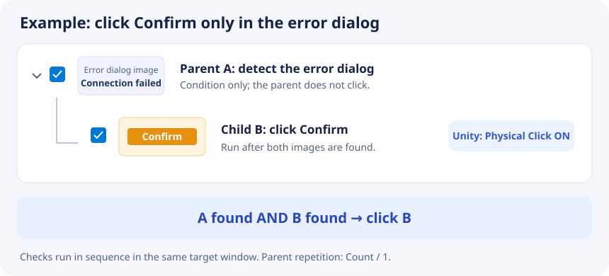

# Diadem Macro

[한국어](README.md) | [English](README.en.md)

  

Diadem Macro is a Windows desktop automation tool that finds registered images in application windows and repeats mouse and keyboard actions. It supports Korean and English.

- Download: [GitHub Releases](https://github.com/EomTaeWook/DiademMacro/releases)
- Supported system: Windows 10 version 2004 or later, x64
- Distribution: one self-contained EXE

Download the Windows x64 EXE, place it in a writable folder, and run it. No installer or separate .NET installation is required. Settings, captured images, and logs are created as separate files during use.

## Features

- Capture application windows and search for registered images
- Image clicks, recorded mouse actions, keyboard input, and clicks relative to an image
- Physical clicks that move the actual mouse cursor
- Regions of interest (ROI), per-trigger similarity, repetition, delays, and jumps to another event
- Search multiple processes or lock execution to one process
- Batch and sequential execution modes
- Copy, reorder, and nest triggers using drag and drop
- Preview the captured image and search results
- Open the log folder and check for stable GitHub updates from Settings

## Quick start

1. Run the target application and the downloaded Macro EXE.
2. Select the target under **Connected Process**. Press **Refresh** if it is missing.
3. Enable the process lock to keep execution on that process.
4. Press **Add** and capture the image to find in the target window.
5. Configure the event and its conditions in Options. **For Unity applications, enable Physical Click on each trigger that performs a click.**
6. Save, check the triggers to run, and press **Start**.
7. Press **Stop** to cancel capture, search, and input operations and wait for execution to finish.

Triggers and captured images are stored in `Save/save.dll` and `Save/img` by default.

## Event types

| Type | Action |
| --- | --- |
| `Image` | Find the registered image and click within the matching area. Regular clicks choose a position inside that area. |
| `Mouse` | Run recorded left-click, right-click, or drag actions. |
| `Keyboard` | Send a key or shortcut such as `CTRL+A` to the target. |
| `RelativeToImage` | Click at an X/Y offset from the center of the matching image. |

## Physical Click for Unity applications

If an image is found in a Unity application but the button does not respond, select the trigger and enable **Options → Input Settings → Physical Click**, then save. Physical Click is available for image clicks and clicks relative to an image. If a child trigger performs the click, enable it on that child.

Physical Click moves the real mouse cursor to the calculated screen position, clicks, and restores its original position.

- Keep the target window visible and not minimized.
- Keep the click position clear of other windows.
- If the target runs as administrator, run Macro at the same privilege level.
- Avoid moving or clicking the mouse while Macro is running.
- Physical Click cannot be combined with dragging between matching images.

Visible windows use Windows Graphics Capture first, including GPU-rendered Unity windows. Minimized GPU-rendered windows may return blank images and are not guaranteed to work.

## Image search settings

- **ROI:** Limit the search to the relevant part of the window.
- **Per-trigger similarity:** `0` uses the common setting; `1–100` applies only to that trigger.
- **Show search results:** Highlight the matching area in the preview.
- **Post-action delay:** Wait after the current action before continuing.
- **Jump to event:** Continue at the specified event number after success; `0` follows the list order.

For faster searches, use an ROI and capture only the relevant target element.

## Child triggers and AND conditions

Drag one trigger onto another to make it a child. A child is checked only after its parent image passes the similarity threshold, providing a **parent condition AND child condition**. A parent with children acts as a condition and does not perform its own click.

### Example: click Confirm only when the error dialog is present

1. Capture the error dialog's identifying title or message in the target application. This is the parent trigger.
2. Capture the **Confirm** button as a separate trigger and drag it onto the parent.
3. Check both triggers and set the parent's repetition to **Count / 1**.
4. For a Unity target, enable **Physical Click** in the **child Confirm trigger's** options and save.
5. Start execution. Macro finds the parent image first, captures the target window again, and searches for the child. The Confirm button is clicked only when the child also passes its threshold.

| Parent dialog image | Child Confirm image | Action |
| --- | --- | --- |
| Not found | Not checked | Skip the child |
| Found | Not found | Do not click |
| Found | Found | Click the child's Confirm button |

Parent and child checks happen in sequence, not atomically on one frame. The child's search area is not automatically limited to the parent image. Set an ROI on the child when needed.

For three conditions before the final action, nest them as `Parent A → Child B → Grandchild C`. Placing B and C beside each other under A checks `A AND B` and `A AND C` separately; siblings do not form one combined AND condition.

### Repetition

- **Count:** Run the child events the specified number of times.
- **Repeat based on child events:** Continue while child events succeed.
- **Stop when parent image is found:** Repeat child events until the parent image is found again.

Drag a child out to a top-level position to make it a top-level trigger again.

## Execution modes

| Mode | Behavior |
| --- | --- |
| Batch | Capture each process once, then check its top-level triggers. This is the default. |
| Sequential | Capture the process again for each top-level trigger. Useful when the screen changes frequently. |

## Settings

| Setting | Purpose |
| --- | --- |
| Language | `Kor` or `Eng` |
| Save path | Location for `save.dll` and the `img` folder |
| Macro mode | Batch or sequential execution |
| Process interval | Delay after processing a target process (ms) |
| Item delay | Delay after an unsuccessful image search (ms) |
| Drag delay | Delay between recorded drag positions (ms) |
| Common similarity | Threshold used when a trigger's similarity is `0` |
| Show search results | Highlight matches in the preview |
| Process position | Move the target window to the configured screen position |
| Open log folder | Open the current log folder in File Explorer |

## Saved data and logs

The save file keeps the name `save.dll` for compatibility, but its contents are JSON. Captured images are stored in the adjacent `img` folder. Older binary saves are converted to the current model when loaded.

Logs are created at `logs/LogFile.txt` after the first log event. Use **Settings → Open Log Folder** to find them.

When reporting a problem, include the steps to reproduce it, the target application, event type, whether Physical Click is enabled, and `logs/LogFile.txt`.

## Updates

Use the update section in Settings to check for the latest stable GitHub release. In-app replacement requires a newer Windows x64 single-file EXE and matching SHA-256 information.

Older ZIP releases do not support this replacement flow. When moving from a ZIP release, download the new EXE manually and keep your existing settings and save files. Future single-file releases can use the update feature in Settings.

## Troubleshooting

### The process is missing

Start the target application and press **Refresh**.

### The image is not found

- Use the same display scaling as when the image was captured.
- Try a lower similarity threshold.
- Make sure the ROI includes the target.
- Capture a tighter image around the target element.

### Unity buttons do not respond

- Enable **Physical Click** on the trigger that performs the action.
- Keep the target visible, with no window covering the click position.
- Match Macro's privilege level to the target application.
- Disable dragging between matching images when using Physical Click.

### The log file is missing

Logs appear after an actual log event. Run an image search or load a save file, then open the log folder again.

## License

[MIT License](LICENSE)

## Bug reports

`enter0917@naver.com`
