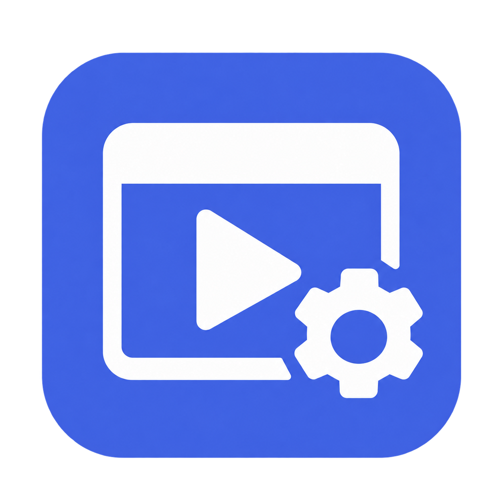
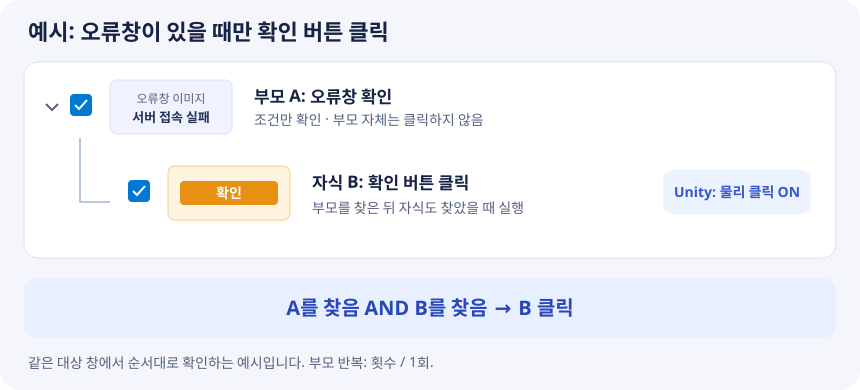

# Diadem Macro

[한국어](README.md) | [English](README.en.md)

  

Diadem Macro는 Windows 프로그램의 화면에서 등록한 이미지를 찾고 마우스·키보드 입력을 반복하는 데스크톱 자동화 도구입니다. Avalonia와 .NET 10으로 동작하며 한국어와 영어 UI를 제공합니다.

- 다운로드: [GitHub Releases](https://github.com/EomTaeWook/DiademMacro/releases)
- 지원 운영체제: Windows 10 버전 2004 이상, x64
- 배포 형식: 자체 포함 단일 `Macro.exe`

GitHub Releases에서 Windows x64용 EXE 하나를 내려받아 쓰기 가능한 폴더에 두고 실행하세요. 설치 프로그램이나 별도 .NET 설치는 필요하지 않습니다. 설정·저장 이미지·로그는 사용 중에 별도 파일로 생성됩니다.

## 주요 기능

- 실행 중인 프로세스의 화면 캡처와 이미지 검색
- 이미지 클릭, 고정 좌표 마우스 입력, 키보드 입력, 이미지 상대 좌표 클릭
- 실제 커서를 움직이는 물리 클릭
- 관심 영역(ROI), 항목별 유사도, 반복, 후 작업 딜레이, 다음 이벤트 이동
- 여러 프로세스 검색 또는 특정 프로세스 고정
- 배치 모드와 순회 모드
- 트리거 복사·이동·드래그 앤 드롭 및 실행 상태 표시
- 실행 화면의 검색 결과 미리보기
- 설정에서 로그 폴더 열기와 GitHub 정식 릴리스 업데이트

## 빠른 시작

1. 자동화할 프로그램과 `Macro.exe`를 실행합니다.
2. **연결된 프로세스**에서 대상 프로그램을 선택합니다. 목록에 없다면 **새로고침**을 누릅니다.
3. 한 프로세스만 대상으로 삼으려면 **고정**을 선택합니다.
4. **추가**를 누르고 대상 창에서 찾을 이미지를 캡처합니다.
5. 옵션에서 이벤트 타입과 실행 조건을 설정합니다. **Unity 프로그램이라면 클릭을 실행할 트리거의 옵션에서 ‘물리 클릭’을 켜세요.**
6. **저장**을 누르고 실행할 트리거의 체크 상태를 확인한 뒤 **시작**을 누릅니다.
7. 종료하려면 **중지**를 누릅니다. 진행 중인 캡처·검색·입력 작업이 취소된 뒤 실행이 종료됩니다.

트리거와 캡처 이미지는 기본적으로 `Save/save.dll`과 `Save/img`에 저장됩니다.

## 이벤트 타입

### Image

등록한 이미지를 찾고 이미지 내부의 위치를 클릭합니다. 일반 클릭은 좌표 패턴을 줄이기 위해 일치 영역 안에서 위치를 선택합니다.

### Mouse

대상 창에서 좌클릭, 우클릭 또는 드래그 좌표를 직접 기록해 실행합니다.

### Keyboard

`CTRL+A`와 같은 키 또는 조합키를 대상 창에 전달합니다.

### RelativeToImage

일치한 이미지의 중심을 기준으로 X·Y 상대 좌표를 더한 위치를 클릭합니다.

## 물리 클릭과 Unity 창

Unity 프로그램에서 이미지 검색은 성공하지만 클릭이 되지 않는다면, 해당 트리거를 선택하고 **옵션 → 입력 설정 → 물리 클릭**을 켠 뒤 **저장**하세요. 이미지 클릭과 이미지 상대 좌표 클릭에서 사용할 수 있습니다. 자식 트리거가 클릭을 담당한다면 그 자식의 옵션에서 켭니다.

**물리 클릭**은 실제 커서를 화면 좌표로 이동해 클릭합니다. 클릭 후 커서는 원래 위치로 돌아갑니다.

다음 조건을 만족해야 합니다.

- 대상 창이 최소화되지 않고 화면에 보여야 합니다.
- 계산된 클릭 지점이 다른 창에 가려져 있으면 안 됩니다.
- 대상 프로그램이 관리자 권한으로 실행 중이라면 Macro도 같은 권한 수준으로 실행해야 합니다.
- 실행 중에는 실제 마우스를 움직이거나 클릭하지 않는 것이 좋습니다.
- **같은 이미지 드래그**와 물리 클릭은 함께 사용할 수 없습니다.

최소화되지 않은 창은 Windows Graphics Capture를 우선 사용하므로 Unity의 GPU 렌더링 화면도 캡처할 수 있습니다. 최소화된 GPU 렌더링 창은 빈 화면이 반환될 수 있으며 정상 동작을 보장하지 않습니다.

## 이미지 검색 설정

- **관심 영역(ROI)**: 검색 범위를 필요한 영역으로 제한합니다. 큰 창이나 작은 비교 이미지를 검색할 때 속도 개선에 가장 효과적입니다.
- **항목별 유사도**: `0`이면 공통 설정값을 사용하고, `1~100`이면 해당 트리거에만 적용합니다.
- **검색 결과 표시**: 일치 영역을 미리보기에 표시합니다.
- **후 작업 딜레이**: 현재 이벤트 실행 후 다음 이벤트까지 기다리는 시간입니다.
- **바로 이동**: 성공 후 지정한 이벤트 번호로 이동합니다. `0`이면 목록 순서를 따릅니다.

이미지 검색이 느리면 먼저 ROI를 지정하고 비교 이미지를 대상 요소에 가깝게 잘라 사용하세요.

## 반복과 하위 이벤트

항목을 다른 항목 위에 드롭하면 자식 이벤트가 됩니다. 부모 이미지가 유사도 조건을 통과해야 자식을 확인하므로 **부모 조건 AND 자식 조건**으로 사용할 수 있습니다. 자식이 있는 부모는 조건 확인 역할을 하며 부모 자체의 클릭은 실행하지 않습니다.

### 예제: 오류창이 있을 때만 확인 버튼 클릭

1. 같은 대상 프로그램에서 오류창을 구분할 제목이나 문구를 이미지로 등록합니다. 이 항목이 부모입니다.
2. **확인** 버튼 이미지를 별도 트리거로 등록하고, 부모 항목 위로 드래그해 자식으로 넣습니다.
3. 두 항목을 체크하고 부모의 반복을 **횟수 / 1회**로 설정합니다.
4. 대상이 Unity 프로그램이면 **자식 확인 버튼 트리거**의 옵션에서 **물리 클릭**을 켜고 저장합니다.
5. 시작하면 부모 이미지를 먼저 찾고, 성공했을 때 화면을 다시 캡처해 자식 이미지를 찾습니다. 자식도 조건을 통과하면 확인 버튼을 클릭합니다.

| 부모 오류창 이미지 | 자식 확인 버튼 이미지 | 동작 |
| --- | --- | --- |
| 없음 | 확인하지 않음 | 자식 실행 안 함 |
| 있음 | 없음 | 클릭 안 함 |
| 있음 | 있음 | 자식 확인 버튼 클릭 |

부모와 자식은 순서대로 확인하므로 동일한 한 프레임의 동시 판정은 아닙니다. 자식의 검색 범위는 부모 이미지 내부로 자동 제한되지 않습니다. 필요하면 자식에도 ROI를 설정하세요.

세 조건을 모두 통과한 뒤 마지막 동작만 실행하려면 `부모 A → 자식 B → 손자 C`로 중첩합니다. 같은 부모 아래에 B와 C를 나란히 두면 `A AND B`, `A AND C`를 각각 확인하며, 형제 B·C 전체를 하나의 AND 조건으로 묶지는 않습니다.

### 반복 설정

- **횟수**: 지정한 횟수만큼 하위 이벤트를 실행합니다.
- **하위 이벤트 기준 반복**: 하위 이벤트가 성공하는 동안 반복합니다.
- **상위 이미지 발견 시 중지**: 상위 이미지를 다시 찾을 때까지 하위 이벤트를 반복합니다.

하위 항목을 목록 바깥쪽이나 최상위 위치로 드롭하면 다시 최상위 항목으로 이동할 수 있습니다.

## 실행 모드

| 모드 | 동작 |
| --- | --- |
| 배치 모드 | 프로세스 화면을 한 번 캡처한 뒤 활성 트리거 목록을 순회합니다. 기본값입니다. |
| 순회 모드 | 트리거마다 프로세스 화면을 다시 캡처하고 검색합니다. 화면 변화가 잦을 때 사용합니다. |

## 설정

| 설정 | 설명 |
| --- | --- |
| 언어 | `Kor` 또는 `Eng` |
| 저장 경로 | `save.dll`과 `img` 폴더를 저장할 위치 |
| 매크로 모드 | 배치 모드 또는 순회 모드 |
| 실행 주기 | 전체 프로세스·트리거 순회 후 대기 시간(ms) |
| 항목 딜레이 | 이미지 검색 실패 후 다음 항목까지 대기 시간(ms) |
| 드래그 딜레이 | 드래그 중 좌표 사이의 대기 시간(ms) |
| 공통 유사도 | 항목별 유사도가 `0`일 때 사용하는 임계값 |
| 검색 결과 표시 | 일치 영역을 미리보기에 표시 |
| 프로세스 위치 | 대상 창을 지정한 화면 좌표로 이동 |
| 로그 폴더 열기 | 현재 로그 폴더를 파일 탐색기로 열기 |

## 저장 파일과 로그

저장 파일 이름은 호환성을 위해 `save.dll`을 유지하지만 현재 내용은 JSON입니다. 캡처 이미지는 같은 저장 경로의 `img` 폴더에 저장됩니다. 이전 바이너리 저장 파일은 읽을 때 현재 모델로 변환합니다.

로그는 첫 로그 이벤트가 발생한 뒤 `logs/LogFile.txt`에 생성됩니다. 설정의 **로그 폴더 열기**로 해당 위치를 바로 열 수 있습니다.

버그를 제보할 때 다음 정보를 함께 보내면 원인 확인에 도움이 됩니다.

- 재현 순서
- 대상 프로그램과 이벤트 타입
- 물리 클릭 사용 여부
- `logs/LogFile.txt`

## 업데이트

설정의 앱 업데이트 영역에서 최신 GitHub 정식 릴리스를 수동으로 확인할 수 있습니다. 더 높은 버전의 Windows x64 단일 실행 파일과 SHA-256 정보가 모두 확인된 경우에만 업데이트 후 재시작을 진행합니다.

ZIP 형태의 이전 릴리스에서 처음 전환할 때는 새 EXE를 직접 내려받고 기존 설정과 저장 파일을 유지하세요. 이후 단일 EXE 릴리스부터 설정의 업데이트 기능을 사용할 수 있습니다.

## 문제 해결

### 프로세스가 목록에 없음

대상 프로그램을 먼저 실행한 뒤 **새로고침**을 누르세요.

### 이미지를 찾지 못함

- 대상 화면 배율과 캡처 당시 배율이 같은지 확인합니다.
- 유사도를 조금 낮춰 확인합니다.
- ROI가 실제 검색 위치를 포함하는지 확인합니다.
- 대상 요소만 포함하도록 비교 이미지를 다시 캡처합니다.

### 물리 클릭이 실행되지 않음

- 대상 창이 최소화됐거나 다른 창에 가려졌는지 확인합니다.
- 대상 프로그램과 Macro의 관리자 권한 수준을 맞춥니다.
- **같은 이미지 드래그**가 선택되어 있지 않은지 확인합니다.

### 로그 파일이 없음

로그 파일은 실제 로그 이벤트가 발생한 뒤 생성됩니다. 이미지 검색이나 저장 파일 로드를 실행한 후 설정에서 로그 폴더를 다시 여세요.

## License

[MIT License](LICENSE)

## 버그 제보

`enter0917@naver.com`
